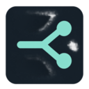

# LavOSC



Модульный приёмник OSC на .NET MAUI 10 для Windows x64. Один UDP-приёмник передаёт сообщения включённым модулям. Модуль «Руль» передаёт наклон телефона на ось X vJoy. Модуль «Педали» передаёт газ и тормоз на оси Y и Z для ETS 2.

## Сборка на Windows

Нужны .NET 10 SDK и рабочая нагрузка `maui-windows`. Если она уже установлена, начни со второй команды.

```powershell
dotnet workload install maui-windows
dotnet publish .\src\LavOSC\LavOSC.csproj -c Release -p:Platform=x64 --self-contained true -p:WindowsAppSDKSelfContained=true -o .\artifacts\publish
.\artifacts\publish\Laveyana.LavOSC.exe
```

Для запуска отладчиком открой `LavOSC.slnx` в Visual Studio с установленной нагрузкой .NET MAUI, выбери конфигурацию **Debug | x64** и назначь `LavOSC` запускаемым проектом с профилем **Windows Machine**.

[Сборка MAUI для Windows](https://learn.microsoft.com/dotnet/maui/windows/deployment/publish-unpackaged-cli?view=net-maui-10.0) · [Релизы vJoy](https://github.com/BrunnerInnovation/vJoy/releases)

## Первый запуск

1. Открой приложение. На **Главной** слева находятся настройки приёма и закреплённых модулей. Справа видны IPv4 компьютера, счётчики OSC и показания закреплённых модулей.
2. В TouchOSC выбери UDP и нажми **Browse** рядом с **Host**. Работающий приёмник объявляет `LavOSC (имя компьютера)` через Zeroconf. Если в списке несколько адресов, выбери IPv4. При ручной настройке укажи IPv4 компьютера и порт LavOSC в **Send Port**. По умолчанию это `8000`.
3. Для руля установи драйвер vJoy с компонентом **Configure vJoy**, включи **Accelerometer (/accxyz)** в TouchOSC и открой экран управления. Подержи телефон в нейтрали примерно секунду и нажми **Выставить центр**. В ручном режиме после калибровки нажми **Включить руль**.
4. Назначь ось X vJoy на руль в настройках ETS 2. Если направления перепутаны, включи **Инверсия руля** слева.

На вкладке **Модули** можно искать по названию и OSC-адресу, настроить выбранный модуль и нажать **На главный экран**. Руль и педали закреплены по умолчанию. Кнопка **Убрать с главной** скрывает карточку. **Включить модуль** и **Отключить модуль** управляют обработкой OSC независимо от закрепления. Приложение сохраняет оба выбора. При первом запуске LavOSC импортирует сохранённые настройки прежней версии, если настройки LavOSC ещё не созданы.

## Педали в TouchOSC и ETS 2

1. В редакторе TouchOSC с поддержкой Lua добавь два вертикальных фейдера с именами `Throttle` и `Brake`, с диапазоном `0…1`. Если к ним добавились OSC-сообщения по умолчанию, отключи их для этих двух фейдеров.
2. Вставь [скрипт педалей](docs/touchosc-pedals.lua) в скрипт корневого документа. Он отправляет обе педали на первом OSC-соединении примерно 25 раз в секунду и сбрасывает каждую в ноль при отпускании пальца. Если LavOSC настроен на другом OSC-соединении, укажи его в последнем аргументе `sendOSC`.
3. На карточке **Педали** нажми **Включить модуль**. Убедись, что меняются показания газа и тормоза, затем нажми **Включить педали**. Для руля и педалей на одном устройстве vJoy нужны оси X, Y и Z. Если у существующего устройства только X, останови передачу в vJoy и включи Y и Z в Configure vJoy либо нажми **Подготовить vJoy** при обоих включённых модулях и автоматическом выборе устройства.
4. В ETS 2 назначь на **Газ** ось Y, на **Тормоз** ось Z и проверь, что при отпускании обоих фейдеров игра показывает ноль. При обратной шкале поменяй режим соответствующей оси в игре.

Если отправляешь педали из своего OSC-клиента, повторяй значения, даже когда они стоят на месте. Через 500 мс без новых данных канал сбрасывается в ноль. Когда пропадают оба канала, LavOSC выключает передачу педалей в vJoy. Для возобновления нажми **Включить педали** после возвращения сигнала.

## Адреса OSC

| Адрес | Кому доставляется |
| --- | --- |
| `/accxyz` | Всем модулям, подписанным на этот адрес |
| `/wheel/calibrate` | Команде калибровки модуля «Руль» |
| `/whell/calibrate` | Той же команде, как псевдоним из исходного примера |
| `/pedals/state` | Газу и тормозу; два аргумента `float` или `double` от `0` до `1`, в указанном порядке |
| `/pedals/throttle` | Газу; один аргумент `float` или `double` от `0` до `1` |
| `/pedals/brake` | Тормозу; один аргумент `float` или `double` от `0` до `1` |
| `/panel/preset/night/2` | Команде `preset` зарегистрированного модуля `panel`, с сегментами `night` и `2` |

Команды имеют форму `/<модуль>/<команда>[/<данные>...]`. Сегменты после команды доступны в `OscCommand.PathData`. Типизированные аргументы самого OSC-сообщения доступны отдельно, в `OscCommand.Envelope.Message.Arguments`.

Для калибровки добавь в TouchOSC кнопку Push с адресом `/wheel/calibrate`. Команда срабатывает на нажатие со значением `1`, `true`, OSC Impulse или без аргументов. Отпускание со значением `0` игнорируется. Руль принимает команду с того же IPv4, с которого получает акселерометр.

## Обратная связь в TouchOSC

1. Укажи **Receive Port** в TouchOSC, например `9000`. Отправь любое OSC-сообщение в LavOSC, чтобы приложение запомнило IPv4 клиента.
2. На вкладке **Клиенты** выбери этот IP, введи его входящий порт, включи **Отправлять состояние** и нажми **Сохранить**. У нового клиента отправка по умолчанию выключена.
3. Включи нужный модуль и нажми **Включить обратную связь** в его карточке. LavOSC отправляет снимок примерно каждые 100 мс выбранным клиентам. В TouchOSC добавь входящие сообщения на адреса ниже и привяжи нужные аргументы к индикаторам.

| Адрес | Аргументы по порядку |
| --- | --- |
| `/wheel/feedback/state` | Положение `float` от `−1` до `1`, угол `float` в градусах, свежий сигнал `bool`, калибровка `bool`, активная передача в vJoy `bool` |
| `/pedals/feedback/state` | Газ `float` от `0` до `1`, тормоз `float` от `0` до `1`, свежий сигнал газа `bool`, свежий сигнал тормоза `bool`, активная передача в vJoy `bool` |

Когда сигнал устаревает, его числовые значения сбрасываются в `0`. Zeroconf объявляет только имя и адрес приёмника с его входящим портом. Снимки состояния передаются отдельными UDP-пакетами на выбранные IP и порты.

## Подключение нового модуля в C#

Добавь `Laveyana.LavOSC.Core` в проект модуля. Это общий API для модулей и хостов на .NET 10. Реализуй `IOscModule` и в `Configure` объяви команды и подписки.

```csharp
using Laveyana.LavOSC.Core;

public sealed class PanelModule : IOscModule
{
    public string Name => "panel";

    public void Configure(OscModuleRegistration registration)
    {
        registration.Subscribe("/accxyz", packet =>
            Console.WriteLine(string.Join(", ", packet.Message.Arguments)));

        registration.OnCommand("preset", command =>
            Console.WriteLine(string.Join("/", command.PathData)));
    }
}
```

Чтобы подключить опубликованный модуль к приложению LavOSC, добавь его пакет в `src/LavOSC/LavOSC.csproj`. В точке входа `MauiProgram.CreateMauiApp()` зарегистрируй его перед `builder.Build()`.

```csharp
// Требуются using Microsoft.Extensions.DependencyInjection; и using Laveyana.LavOSC.Core;
builder.Services.AddSingleton<IOscModule, PanelModule>();
```

Каждый `IOscModule` из DI появится в каталоге. При включении вызывается `Configure`, а после выключения новые сообщения в модуль не поступают. Уже начатый обработчик может закончить выполнение. Имена `wheel`, `whell` и `pedals` зарезервированы за встроенными модулями.

Если модуль поддерживает обратную связь, реализуй `IOscFeedbackSource`. Метод `GetFeedback()` вызывается в фоновом потоке и возвращает готовые снимки. Приложение добавляет префикс `/<модуль>/feedback/` и отправляет пакеты выбранным клиентам. Пример для `PanelModule`.

```csharp
public IReadOnlyList<OscFeedback> GetFeedback() =>
    [new("status", ["ready", 1.0f])]; // /panel/feedback/status
```

В собственном хосте можно использовать тот же API напрямую.

```csharp
var router = new OscRouter();
using var registration = router.Register(new PanelModule());
using var receiver = new OscUdpReceiver(8000, router);
```

`IDisposable` из `Register` отключает команды и подписки модуля. У каждого модуля собственная очередь на 64 доставки. Если она заполнится, пропуск учитывается в диагностике. Обработчики одного модуля выполняются по порядку, а ошибки и задержки одного обработчика не останавливают доставку остальным.

## Автоподготовка vJoy

- Приложение ищет `vJoyInterface.dll` в зарегистрированной установке vJoy и в стандартных каталогах Program Files. Поле пути можно оставить пустым или указать путь к 64-битной DLL. Новый путь к DLL вступает в силу после полного перезапуска приложения.
- Если интерфейс vJoy недоступен, приложение читает состояние устройства в Windows. При коде 22 оно пробует включить найденное отключённое устройство через PnPUtil. При других ошибках справа появляется код. Приложение ищет устройство с нужными осями и отдаёт приоритет устройству, которое уже использует другой модуль LavOSC, если нужные оси на нём свободны.
- Если подходящего устройства нет, **Подготовить vJoy** может создать новое с осями X, Y и Z через `vJoyConfig.exe`. Windows может запросить разрешение UAC. Сначала выключи передачу руля и педалей, поскольку создание может кратковременно переподключить устройства vJoy.
- При ручном выборе номера приложение использует этот номер. Возврат к пункту **Автоматически** включает поиск по всем 16 номерам. Кнопка **Подготовить vJoy** повторяет поиск после установки, изменения настроек или отмены запроса Windows.
- Автоматическое создание через повышенный процесс доступно для штатной установки vJoy. Оси можно настроить вручную через **Configure vJoy**.
- При пропадании данных с телефона примерно на 350 мс приложение возвращает руль в центр и освобождает виртуальное устройство. После восстановления связи нажми **Включить руль**.

## Настройки руля

- **Угол от центра до упора**. По умолчанию `60°` в каждую сторону, диапазон настройки от `25°` до `110°`.
- **Мёртвая зона**. По умолчанию `2°`. В этом диапазоне приложение отправляет центральное положение оси.
- **Сглаживание**. По умолчанию `55 мс`. Уменьши значение, если нужен более резкий отклик.
- Настройки сохраняются. После нового запуска приёма центр выставляется по текущему хвату.

Если сообщений нет, проверь общий роутер, IPv4 компьютера, порт и разрешение входящего UDP в частной сети Windows. Закрой диагностический приёмник, если он слушает этот же порт. При смене IP телефона останови и снова запусти приём.

## Сборки и пакеты NuGet

| Сборка | Назначение | Пакет NuGet |
| --- | --- | --- |
| `Laveyana.LavOSC` | Интерфейс MAUI и Windows-адаптер к vJoy | — |
| `Laveyana.LavOSC.Core` | Контракты модулей, приём UDP, парсер и маршрутизация OSC | `Laveyana.LavOSC.Core` |
| `Laveyana.LavOSC.Modules.Wheel` | Модуль руля, калибровка и интерфейс `ISteeringOutput` | `Laveyana.LavOSC.Modules.Wheel` |
| `Laveyana.LavOSC.Modules.Pedals` | Газ, тормоз и интерфейс `IPedalOutput` | `Laveyana.LavOSC.Modules.Pedals` |

Для упаковки библиотек достаточно .NET 10 SDK.

```powershell
dotnet pack src/LavOSC.Core/LavOSC.Core.csproj -c Release -o artifacts/nuget
dotnet pack src/LavOSC.Modules.Wheel/LavOSC.Modules.Wheel.csproj -c Release -o artifacts/nuget
dotnet pack src/LavOSC.Modules.Pedals/LavOSC.Modules.Pedals.csproj -c Release -o artifacts/nuget
```

Публикуй сначала Core, потом модули руля и педалей. Оба зависят от Core.

```powershell
dotnet nuget push artifacts/nuget/Laveyana.LavOSC.Core.0.1.0.nupkg --source https://api.nuget.org/v3/index.json --api-key $env:NUGET_API_KEY
dotnet nuget push artifacts/nuget/Laveyana.LavOSC.Modules.Wheel.0.1.0.nupkg --source https://api.nuget.org/v3/index.json --api-key $env:NUGET_API_KEY
dotnet nuget push artifacts/nuget/Laveyana.LavOSC.Modules.Pedals.0.1.0.nupkg --source https://api.nuget.org/v3/index.json --api-key $env:NUGET_API_KEY
```


## Публикация на GitHub

Распакуй исходники в отдельную папку и выполни из неё эти команды. Для последней команды нужен [GitHub CLI](https://cli.github.com/) с авторизацией через `gh auth login`.

```powershell
git init -b main
git add .
git commit -m "Initial LavOSC release"
gh repo create LavOSC --public --source=. --remote=origin --push
```

GitHub Actions запускается вручную через **Actions → Windows → Run workflow**. Сборка сохраняет автономную версию для Windows x64 в артефактах запуска. Распакуй архив целиком и запусти `Laveyana.LavOSC.exe`.

Чтобы собрать и опубликовать релиз, отправь тег формата `vMAJOR.MINOR.PATCH` и вручную запусти workflow для этого тега через GitHub CLI.

```powershell
git tag -a v0.1.0 -m "LavOSC v0.1.0"
git push origin v0.1.0
gh workflow run windows.yml --ref v0.1.0
```

Этот запуск прикрепит `LavOSC-win-x64.zip` к GitHub Release для выбранного тега.

Отдельное задание сохраняет `.nupkg` в артефакте `LavOSC-nuget`. При сборке по тегу версия пакетов берётся из тега. Публикация на NuGet выполняется командами выше.

## Лицензия

Исходный код распространяется по [MIT](LICENSE). Для модуля руля vJoy устанавливается отдельно.
